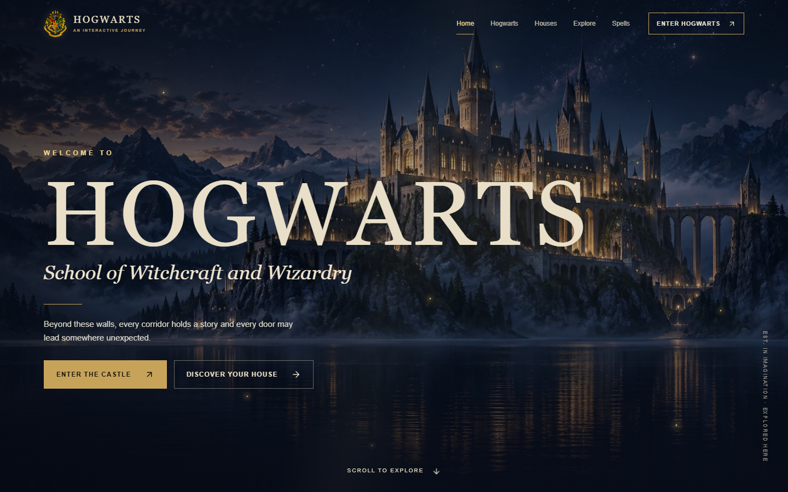
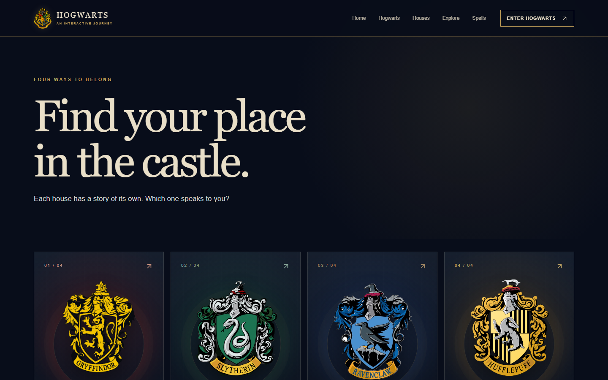

# Hogwarts — Magical Frontend Experience

An unofficial, fan-made frontend portfolio project: a cinematic invitation to explore Hogwarts. The layout, supporting copy, interface, and castle artwork are original. Harry Potter and related properties belong to their respective rights holders.

## Features

- Five main routes: home, castle, houses, locations, and spellbook
- Four house detail pages and a fan-made five-question house discovery
- Searchable spellbook with category filters and small visual spell effects
- Eight castle locations with accessible detail dialogs
- Responsive navigation, subtle reveals, and a CSS illustrated staircase and map

## Tech stack

Next.js 16 App Router, React 19, TypeScript in strict mode, Tailwind CSS 4, Motion for React, and Lucide icons. This project has no server-side data, API, CMS, authentication, or database.

## Screenshots






## Interactive experiences

The discovery quiz scores five original questions in React state and selects the house with the highest score. Ties resolve in a stable order. The spellbook filters local data instantly; each spell triggers a small, nonblocking stage effect. Location cards open detail dialogs with Escape handling, focus containment, body scroll locking, and focus restoration.

Cross-page links use native document navigation. This avoids a [reported Next.js 16 static-export RSC path mismatch](https://github.com/vercel/next.js/issues/85374) on Windows-built static sites, while keeping direct links and refreshes reliable on Cloudflare Pages.

## Animation strategy

Motion handles section reveals, mobile navigation, dialogs, and filtering. CSS handles the quiet ambient details, including stars, letters, candlelight, and the staircase. Reduced-motion preferences disable decorative CSS animation and shorten interface transitions. No video or large particle engine is loaded.

## Responsive design

The layout adapts from a single column on narrow phones to broader compositions on tablet and desktop. Cards retain clear tap targets and do not depend on hover. The mobile menu is full screen and keyboard accessible.

## Accessibility

The site includes semantic landmarks, a skip link, visible focus styles, labelled controls, reduced-motion support, descriptive image alt text, keyboard operable dialogs, and a mobile menu with focus containment.

## Performance

The original hero artwork is stored as a small WebP asset. Next.js `Image` reserves layout space and lazy loads noncritical uses. Static export generates HTML for every route, while interactive code is limited to client components.

## Project structure

```text
src/app/          Routes, metadata, and global styles
src/components/   Navigation, cards, dialogs, quiz, and spellbook
src/data/         Typed local content
public/images/    Original optimized artwork
```

## Installation and local development

Requires Node.js 20.9 or newer. No environment variables are needed.

```bash
npm install
npm run dev
```

Visit `http://localhost:3000`.

## Build and checks

```bash
npm run typecheck
npm run lint
npm run build
```

The static site is emitted to `out/`. To inspect that output locally, use any static file server capable of serving nested `index.html` routes.

## Cloudflare deployment

This frontend uses Next.js static export, a [documented Cloudflare Pages deployment path](https://developers.cloudflare.com/pages/framework-guides/nextjs/deploy-a-static-nextjs-site/). It does not need a Next.js server at runtime. The `next/image` optimization service is disabled because images are optimized before commit. All house routes are generated during build.

For GitHub integration, create a Cloudflare Pages project from the repository and select **Next.js (Static HTML Export)**. Use `npm run build` as the build command and `out` as the output directory. Each push to the production branch triggers a deployment. The `wrangler.jsonc` file records the same output directory for local/direct deployment.

For a manual deployment after authenticating Wrangler and creating a Pages project called `hogwarts-experience`:

```bash
npm run deploy:cloudflare
```

Cloudflare documentation: [static Next.js on Pages](https://developers.cloudflare.com/pages/framework-guides/nextjs/deploy-a-static-nextjs-site/), [Wrangler Pages configuration](https://developers.cloudflare.com/pages/functions/wrangler-configuration/).

## Live demo

Add your Cloudflare Pages URL here after deployment.

## GitHub repository

Add your repository URL here after publishing.

## Disclaimer

The site footer displays © 2026 Hogwarts Interactive Journey and updates the year automatically in the browser.
